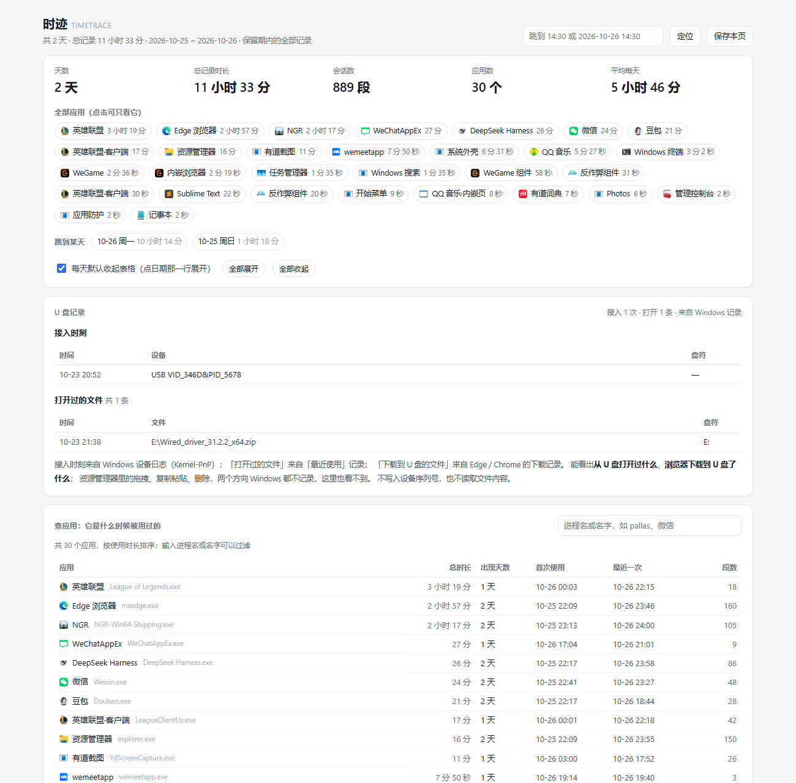
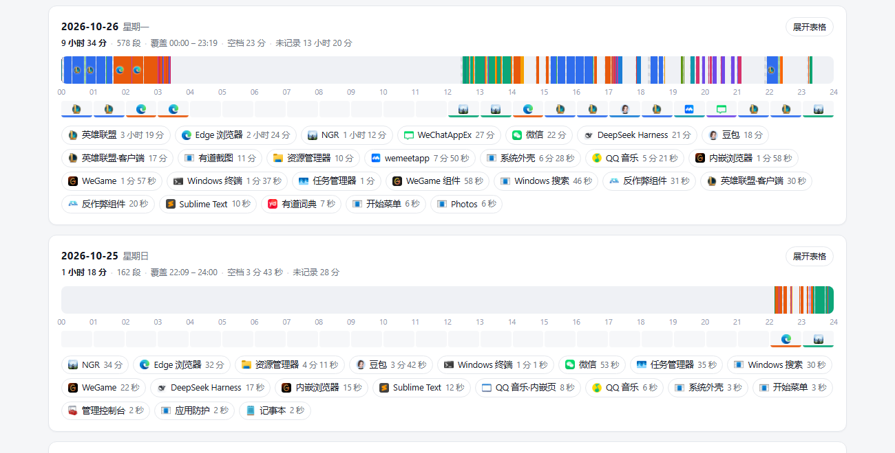

# 时迹 TimeTrace

**给 RustTimeNoter 装一条时间线：一眼看清「什么时候用了什么软件」。**

RustTimeNoter 记下了你每天的电脑使用情况，但它自带的报表只回答「某个应用一共用了多久」。
时迹读它的数据，把零散记录还原成一段段会话，生成一张**本地、离线、可搜索**的时间线：

- **真实应用图标**：直接从本机 exe 里提取，不是色块猜的
- 24 小时色带：鼠标移上去就显示那一刻在用什么、这一段从几点到几点
- **每小时主力应用**：色带下面一排图标，一眼看出每个小时主要在用什么
- **U 盘记录**：什么时候插过 U 盘，以及从 U 盘打开过哪些文件
- 每天一张卡片：应用合计 + 完整会话表，打开即全部展开
- 查某个软件：看到一个陌生进程名，输入几个字母就知道它什么时候跑过
- 查某个时刻：输入 `14:30`，直接跳到那一刻并高亮
- 保存成独立 HTML：一份报告一个文件，图标和数据都在里面

> 时迹**不是**数据采集器。记录原始数据的是 **RustTimeNoter**，本项目只是它的查看器，
> 详见文末[致谢](#致谢)。



## 快速开始

1. 先装好 **RustTimeNoter**（本工具只读它的数据；没装的话时迹也会提示你）
2. 下载 [`TimeTrace-1.6.0-win64.zip`](../../releases/download/v1.6.0/TimeTrace-1.6.0-win64.zip)（约 27 MB，或到 [Releases](../../releases) 看所有版本），解压到任意位置
3. 双击 **`时迹.bat`** —— 右下角出现托盘图标，控制台窗口自动隐藏

不需要安装 Python、不需要管理员权限、不联网。

## 托盘图标

双击 `时迹.bat` 后，任务栏右下角会出现一个蓝色的**时迹图标**（控制台会自己藏起来）。
**右键**它就是菜单：

| 菜单项 | 作用 |
| --- | --- |
| 打开时间线（所有日子、图标、U 盘） | 生成并打开时间线页面（**左键单击图标**也是这个） |
| 查某个时刻在用什么 | 输入 `14:30`，回答那一刻在用什么 |
| 查某个软件什么时候被用过 | 输入 `pallas`，查它什么时候跑过 |
| 查 U 盘：接入 / 打开 / 下载 | 三段式 U 盘记录 |
| 某个日期的文字流水 | 输入日期，打印当天的流水 |
| 记录器状态与数据位置 | 记录器是否在跑、数据与缓存路径 |
| 开机自动启动 | 勾选后时迹随开机进托盘 |
| 退出 | 关掉托盘图标（不影响记录器） |

几个细节：

- 托盘启动时会**自动确保记录器在跑**；没有开机自启也会提醒（可在菜单里勾选）
- 选中的操作会弹一个小控制台窗口显示结果，看完关掉就回到托盘
- 已经有一个托盘在跑时，再双击 `时迹.bat` 不会开第二个

## 命令行（脚本或快捷方式里用）

| 命令 | 作用 |
| --- | --- |
| `TimeTrace.exe --tray` | 启动托盘图标 |
| `TimeTrace.exe html` | 生成并打开时间线 |
| `TimeTrace.exe at "14:30"` | 那一刻在用什么 |
| `TimeTrace.exe app pallas` | 这个程序什么时候被用过 |
| `TimeTrace.exe day --date 2026-10-26` | 某天的文字流水 |
| `TimeTrace.exe events` | U 盘接入 / 打开 / 下载记录 |
| `TimeTrace.exe status` | 记录器状态与路径 |
| `TimeTrace.exe prune --dry-run` | 预演清理过期数据 |
| `TimeTrace.exe --menu` | 控制台菜单（托盘之外的备用入口） |

## 时间线页面

打开后从上到下：

- **总览**：天数、总记录时长、会话数、应用数、平均每天
- **查应用**：每个应用的总时长、出现天数、首次使用、最近一次、段数；输入框过滤，点一行只看它
- **全部应用**：完整列出（不省略），点一下按应用过滤整页
- **跳到某天**：日期锚点
- **每天一张卡片**：24 小时色带 + 每小时主力应用图标 + 当天应用合计 + 当天完整会话表
- **收起 / 展开**：勾选「每天默认收起表格」后点日期那一行展开；也有全部展开 / 全部收起
- **保存本页**：把当前报告另存为独立 HTML（数据内嵌在文件里）

色带里灰色斜纹 = 有记录但未归属到应用的空档；空白 = 完全没有记录（关机 / 睡眠 / 未运行）。
相邻的同一应用记录（间隔 ≤ 3 秒）已合并成一段会话。

色带下面那排小格子是**每小时的主力应用**，点格子就只看它：



## U 盘记录

页面顶部会多一张「U 盘记录」卡片，分三块：

**① 接入时刻** —— 来自 Windows 设备日志 `Microsoft-Windows-Kernel-PnP/Configuration`
（读它不需要管理员权限）：

| 时间 | 设备 | 盘符 |
| --- | --- | --- |
| 10-23 20:52 | USB VID_346D&PID_5678 | — |

- 只取设备实例形如 `USB\VID_*`、且驱动是 `usbstor.inf` 的设备，也就是 U 盘 / USB 移动硬盘；
  键盘鼠标、蓝牙适配器、摄像头不会算进来
- 只记接入时刻，系统没有可靠的「拔出」事件；同一次插拔会连写两条事件，
  5 分钟内的同型号合并成一次
- 盘符从 `HKLM\SYSTEM\MountedDevices` 按设备反查，从没分配过盘符就显示 `—`

**② 打开过的文件** —— 来自 Windows 的「最近使用」记录（`%APPDATA%\Microsoft\Windows\Recent`）：

| 时间 | 文件 | 盘符 |
| --- | --- | --- |
| 10-23 21:38 | E:\Wired_driver_31.2.2_x64.zip | E: |

- 只列出目标在**可移动盘**上的条目；指向本机固定硬盘、光驱、网络盘的一律排除
- 如果那个盘符现在已不存在（U 盘拔了），也会保留下来
- 同一路径只保留最新一条，最多 300 条

**③ 下载到 U 盘的文件** —— 来自 Edge / Chrome 的下载记录：

| 时间 | 文件 | 大小 | 盘符 |
| --- | --- | --- | --- |
| 10-23 21:38 | E:\drivers\Wired_driver_31.2.2_x64.zip | 50.0 MB | E: |

- 浏览器下载时会记住**保存路径**，下载目标落在 U 盘上就能证明「电脑下好放到 U 盘」
- 读的是各浏览器配置的 `History` 数据库（SQLite）：**先复制一份再查**，不改动原文件
- 只取完成/已确定目标的下载，目标在本机硬盘、光驱、网络盘的一律排除

**方向能看出一部分**：

- ② 说明「这个文件是**在 U 盘上**被打开的」——如果当时是拖到本机再打开，最近使用里会是 `C:\...` 的路径
- ③ 说明「**下载直接落到 U 盘**」，即电脑 → U 盘
- 但**拖拽、复制粘贴、右键发送到**，两个方向 Windows 都不留痕，这里也看不到；
  想知道「拷走了什么」，只能事前开对象访问审核（需要管理员、只对之后生效、日志量极大）
  或装 Sysmon 之类的监控，历史补不回来

其他说明：

- 范围默认最近 30 天，`--days 7`、`--from/--to` 同样生效
- 不写入设备序列号，也不读取任何文件内容
- 不想读这些记录可以加 `--no-events`
- 命令行看同样的内容：`TimeTrace.exe events`（或双击 `查U盘.bat`）

## 保留 30 天，过期自动清理

- 每次运行都会先清理：删除 `%LOCALAPPDATA%\RustTimeNoter\data\YYYY\MM\` 下日期早于 30 天的 `YYYY-MM-DD.log`
- 只删严格匹配 `YYYY-MM-DD.log` 的分片；配置、密钥、字典和其它文件一律不碰
- 页面默认范围同样是最近 30 天
- 先看会删什么：`TimeTrace.exe prune --dry-run`
- 改保留期：`TimeTrace.exe prune --days 60` 或 `TimeTrace.exe html --retention 60`
- 临时不清理：`TimeTrace.exe html --no-prune`

> **注意：这是硬删除，不进回收站。** 想长期留存请用页面上的「保存本页」，或定期备份数据目录，或fork到自己仓库修改为你需要的范围。

## 命令行

```
TimeTrace.exe html                     生成时间线并打开浏览器
TimeTrace.exe html --days 7            只看最近 7 天
TimeTrace.exe html --from 2026-10-01 --to 2026-10-31
TimeTrace.exe html --out report.html --no-open
TimeTrace.exe at "14:30" --context 20  某一时刻 + 前后 20 分钟
TimeTrace.exe app pallas --gap 600     查应用；间隔 10 分钟内的使用合并成一个时段
TimeTrace.exe events                   列出 U 盘接入记录
TimeTrace.exe day --date 2026-10-26    某天的文字流水
TimeTrace.exe prune --dry-run          预演清理
TimeTrace.exe --version
```

`html` / `day` / `app` / `events` 都支持 `--days`、`--from`、`--to`、`--retention`、`--no-prune`；
`html` 还支持 `--no-icons`（不取图标，页面里只用色块）和 `--no-events`（不读 U 盘记录）。

## 应用图标是怎么来的

- **本地提取**：按数据里记录的 exe 路径，读该程序自己的图标资源（Windows 自带能力），
  不联网、不从图标库下载、也不靠文件名猜
- **缓存**：提取出来的 PNG 存在 `%LOCALAPPDATA%\TimeTrace\icons`，一个图标约 1.5 KB；
  按「路径 + 文件大小 + 修改时间」做键，程序升级后图标会自动刷新
- **只跑一次**：首次遇到新应用时多花约 0.8 秒（30 个应用约 1.2 秒，之后 0.4 秒）；
  缓存命中后完全不调用外部进程
- **内嵌进页面**：图标以 base64 写进 HTML，整页因此多 60–100 KB；「保存本页」拿到的是
  自带图标的单文件，换台电脑打开也不掉图
- **取不到就回退**：UWP 应用、已卸载程序、权限受限的路径可能拿不到图标，
  这些应用自动退回原来的色块，不会报错

不想用图标可以加 `--no-icons`，页面和以前一模一样。

## 隐私

- 数据始终在 `%LOCALAPPDATA%\RustTimeNoter`，时迹只读取此数据
- 应用图标从本机 exe 本地提取，只存在本机缓存目录，同样不上传
- U 盘记录读取的是本机 Windows 设备日志、「最近使用」记录和**浏览器下载记录**，
  只有时间、设备 ID、盘符和文件路径，不读文件内容、不存设备序列号；
  浏览器数据库是先复制再查，不改动原文件
- 页面是本地静态 HTML，数据内嵌其中，不会上传任何东西
- 本工具不收集遥测、不含网络请求

## 常见问题

**双击后提示「找不到 tracker.exe」**
说明还没装 RustTimeNoter，或者它装在非默认位置。先安装 RustTimeNoter；也可以把
`tracker.exe` 直接放到 TimeTrace.exe 旁边。

**杀毒软件报毒**
`TimeTrace.exe` 由 PyInstaller 打包，未签名，部分杀软会对这类 exe 误报。
源码就在仓库里，可以自己用 `build.ps1` 重新打包，或者直接用 Python 跑源码（见下）。

**为什么只有 30 天数据**
这是默认保留期，见上一节。想留更久就调大 `--days` / `--retention`，并定期「保存本页」或备份数据目录。

**时间线上的空白与灰色斜纹**
空白 = 那段时间完全没有记录（关机、睡眠、daemon 没运行）；灰色斜纹 = 有记录但没归属到应用的空档。

**图标会不会拖慢电脑？**
不会。图标只在你双击「时间线」生成页面时读一次，之后走缓存；不新增常驻进程、不轮询，
RustTimeNoter 的采集端完全不受影响。整页多出 60–100 KB，对浏览器没有可感知的负担。

**凌晨 0 点到 8 点打开，只有昨天没有今天？**
1.4.1 已修复。日志是按 **UTC 日** 分片的，本地 0:00–8:00（UTC+8）这段时间，
记录还写在名叫「昨天」的文件里；旧版拿最后一个分片的文件名当结束日期，就把当天漏了。
现在统一用本地「今天」作为结束日期。

## 用 Python 直接运行（不打包）

需要 Python 3.9+，无第三方依赖：

```
python timetrace.py html
python timetrace.py app weixin
```

## 自己打包

```
powershell -ExecutionPolicy Bypass -File build.ps1
```

会调用 PyInstaller 生成 `dist\TimeTrace.exe`（需要 `pip install pyinstaller`）。

## 致谢

时迹是在别人的基础上做的：

- **RustTimeNoter** 是采集器。它负责把前台窗口、使用时长、AFK 判定这些
  原始数据记下来并加密存放在 `%LOCALAPPDATA%\RustTimeNoter`，
  只是读它导出的数据、把它变成看得懂的时间线。没有 RustTimeNoter，就没有这个页面。
  RustTimeNoter 及其版权归原作者所有。
- 感谢 RustTimeNoter 的作者把「按 UTC 日分片 + 加密日志 + 官方导出接口」这套东西做的十分完善，
  时迹才能只靠 `tracker export` 就拿到完整数据。
- 选择在**RustTimeNoter**优化是因为我很喜欢它的开机自启功能，如果能加个图标就更好了（后续优化方向）

RustTimeNoter 这个软件还是比较知名的，这里就不给出它的仓库地址了，所以这里以项目名致谢

## 许可

MIT，见 [LICENSE](LICENSE)。

时迹与 RustTimeNoter 作者无关，是社区写的第三方查看器；RustTimeNoter 的名称与代码版权归其作者。
